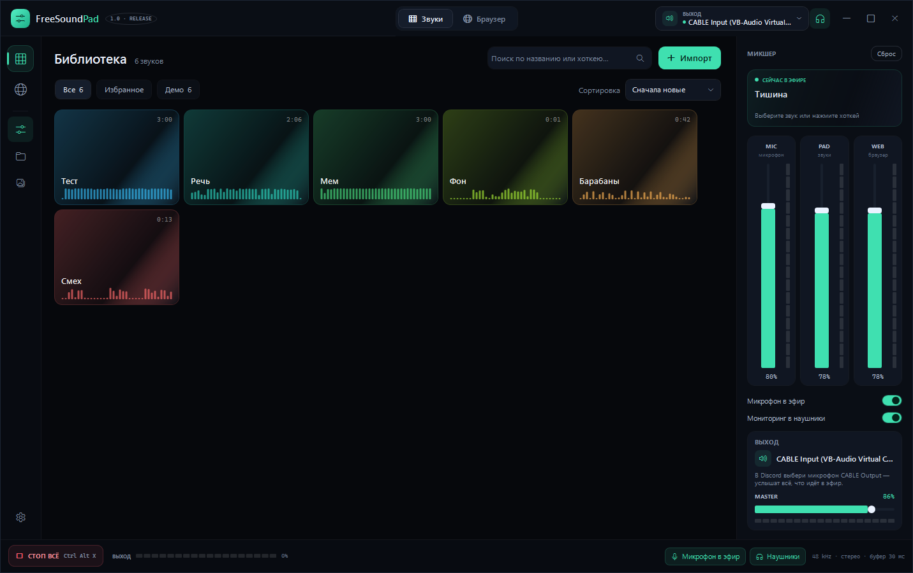
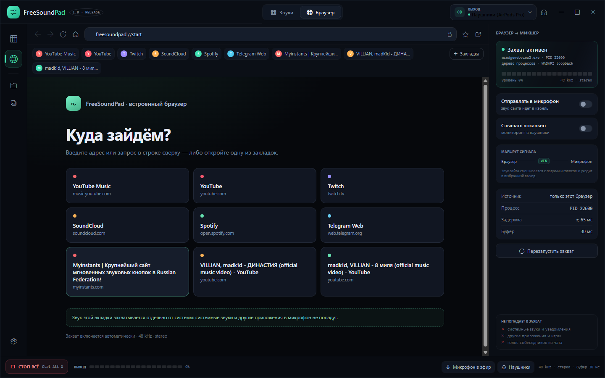
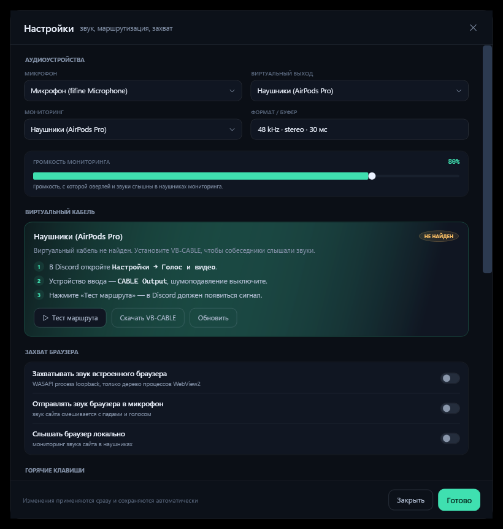
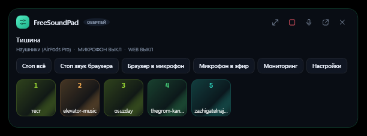
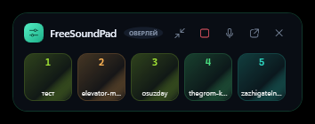
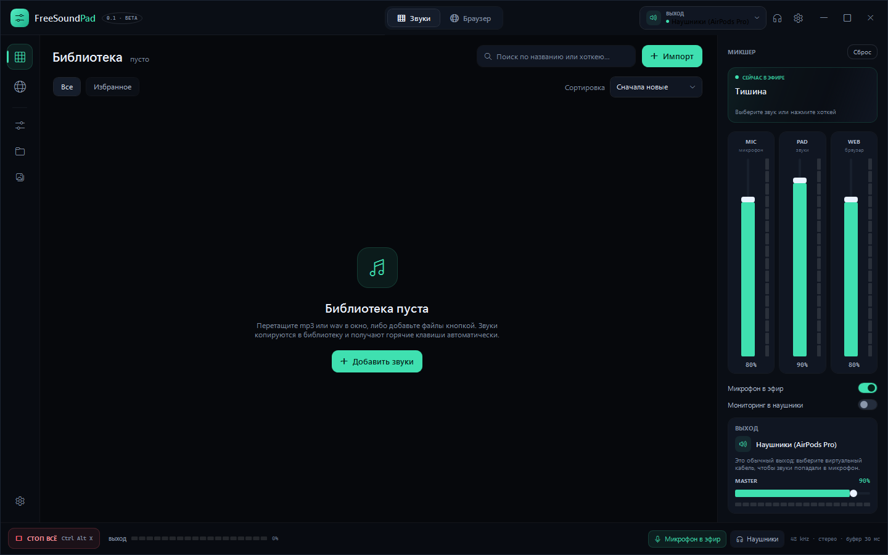

# FreeSoundPad

**Версия 1.1 · Windows 10/11 x64 · готовый релиз**

**Сайт:** https://evgenka-plussss.github.io/FreeSoundPad/

Аналог SoundPad для Windows: **звуковая панель + встроенный браузер**. Звуки из библиотеки и звук сайтов из встроенного браузера сводятся с голосом микрофона и уходят в виртуальный микрофон — собеседники в Discord/игре слышат и голос, и звуки. При этом захватывается **только звук встроенного браузера**, а не всей системы.



## Возможности

- **Звуковая панель:** импорт mp3/wav/m4a/aac/wma/flac, drag&drop, пады с цветами, поиск, категории, избранное, громкость, loop, «стоп всё», прогресс воспроизведения. Одновременно играет **только один пад** — новый автоматически останавливает предыдущий.
- **Большие библиотеки:** при большом числе звуков список выдаётся порциями по 60 карточек с кнопкой «Показать ещё», поиск с debounce-задержкой — интерфейс не подвисает на сотнях файлов.
- **Встроенный браузер** на WebView2: адресная строка, навигация, **закладки** (переносятся на новую строку, не обрезаются), стартовая страница с быстрыми ссылками, «+ Закладка», единое тёмное контекстное меню для падов и браузера.
- **Захват звука только браузера** через WASAPI process loopback по дереву процессов WebView2. Системные звуки, другие приложения и голос собеседников в захват не попадают. При отправке/мониторинге сайт автоматически приглушается локально и захватывается с цифровой компенсацией — без двойного звука.
- **Микшер:** каналы `MIC` / `PAD` / `WEB` + `MASTER` с вертикальными фейдерами, VU-метрами и мастер-лимитером. Боковое меню (микшер) скрывается/показывается кнопкой-слайдерами на левой панели.
- **Микрофон в эфир** (passthrough) и **мониторинг** падов/браузера в наушники (отдельное устройство) с отдельной громкостью мониторинга.
- **Глобальные горячие клавиши:** на пады назначается **любая комбинация клавиш** — `A + B`, `Ctrl + Shift + F`, `* + Num 0` (по умолчанию биндов нет). Если комбинация уже занята, диалог покажет предупреждение и не заменит существующий бинд. Плюс «Стоп всё», микрофон, браузер, мониторинг, оверлей и показать окно — тоже переназначаются.
- **Веб-пульт:** встроенный LAN-сервер для телефона — пады, избранное, поиск, стоп, микрофон, браузер, мониторинг, уровни и навигация по сайтам. Доступ по коду, адрес в настройках.
- **Оверлей поверх окон** в двух размерах: компактная панель с падами и большая информативная версия со статусами, «Стоп всё», стопом звука браузера, отправкой браузера в микрофон, микрофоном, мониторингом и настройками. Перетаскивается за шапку, `Esc` скрывает.
- **Локальный режим:** если виртуального кабеля нет, приложение честно предупреждает и играет звук в выбранное устройство, не притворяясь микрофоном.
- **Настройки — модальное окно:** пока они открыты, главное окно и оверлей недоступны, горячие клавиши снимаются.
- **Трей:** сворачивание/закрытие в трей, меню, возврат окна, автозапуск с Windows.
- **Portable-режим:** `portable.txt` рядом с exe — все данные в папке `Data` рядом с программой.











## Быстрый старт

1. **Скачайте сборку** — [`builds/FreeSoundPad-1.1-win-x64.zip`](builds/FreeSoundPad-1.1-win-x64.zip) или [последний GitHub Release](https://github.com/EvGeNkA-PLUSsss/FreeSoundPad/releases/latest). Внутри — `FreeSoundPad.exe` для Windows 10 2004+ / Windows 11, x64, без установки .NET. WebView2 Runtime на Windows 11 уже есть; если браузер не запускается — установите [WebView2 Runtime](https://developer.microsoft.com/microsoft-edge/webview2/).
2. **Поставьте виртуальный аудиокабель** — без него Windows не даст приложению притвориться микрофоном. Бесплатный вариант: [VB-CABLE](https://vb-audio.com/Cable/) (после установки перезагрузите ПК). Подойдут также VoiceMeeter и Virtual Audio Cable — приложение находит их автоматически.
3. **Настройте маршрут** (кнопка «Настройки» → «Виртуальный кабель»):
   - выход FreeSoundPad → `CABLE Input (VB-Audio Virtual Cable)`;
   - в Discord: `Настройки → Голос и видео → Устройство ввода` → `CABLE Output (VB-Audio Virtual Cable)`;
   - в Discord выключите шумоподавление, иначе оно «съест» музыку и звуки;
   - нажмите **«Тест маршрута»** — в Discord должен появиться сигнал.
4. **Импортируйте звуки** (кнопка «Импорт» или drag&drop mp3 в окно). Хоткеи больше не создаются автоматически: клавиша на пад назначается вручную через контекстное меню.
5. Включите **«Микрофон в эфир»**, если хотите, чтобы собеседники слышали ещё и голос.

Схема:

```
FreeSoundPad (MIC + PAD + WEB → мастер-лимитер) ──► CABLE Input
                                                     │
Discord / игра ◄── микрофон CABLE Output ◄───────────┘
```

## Встроенный браузер: как это работает

Захват идёт не системным loopback, а **WASAPI process loopback** для процесса `msedgewebview2.exe`, принадлежащего нашему окну (`CoreWebView2.BrowserProcessId`, включая дерево процессов). Поэтому в микрофон попадает только звук сайтов из встроенного браузера. Если переключиться на вкладку «Звуки», браузер продолжает играть и захватываться (проверено, см. раздел «Проверено»).

В панели справа видно статус захвата, PID, уровень, формат и кнопку перезапуска. Если браузерный процесс перезапустился (краш/обновление) — захват переподключается автоматически.

Переключатели звука сайта работают без эха: если включено **«Отправлять в микрофон»** или **«Слышать локально»**, прямой звук WebView2 приглушается до 1%, а захваченный сигнал усиливается цифрово. Когда оба выключены, сайт играет напрямую в обычном режиме. «Слышать локально» выводит звук сайта в устройство мониторинга.

## Горячие клавиши по умолчанию

| Действие | Клавиши |
|---|---|
| Пады | **любая комбинация клавиш**, назначается вручную; по умолчанию не назначено |
| Стоп всё | `Ctrl + Alt + X` |
| Микрофон в эфир | `Ctrl + Alt + M` |
| Отправка браузера | `Ctrl + Alt + B` |
| Мониторинг | `Ctrl + Alt + H` |
| Оверлей | `Ctrl + Alt + O` |
| Показать окно | `Ctrl + Alt + F` |

Хоткей пада меняется через контекстное меню пада → «Горячая клавиша…». Зажми и удерживай любые клавиши — `A + B`, `Ctrl + Alt + X`, `* + Num 0` — затем отпусти: комбинация назначится. Одиночная буква или цифра без модификатора перехватывается глобально, поэтому для неё диалог попросит подтверждение **Enter**. Если комбинация уже используется другим падом или командой, появится предупреждение, а старый бинд останется на месте. `Esc`, `Backspace` и `Delete` по умолчанию управляют диалогом; чтобы назначить их, нажми кнопку **«Служебные»**, затем клавишу.

Снять бинды сразу со всех падов: **Настройки → Бинды падов → «Снять все бинды»**. Действие требует подтверждения и не удаляет сами звуки.

## Веб-пульт с телефона

В приложении есть встроенный HTTP-сервер для управления со смартфона или планшета в той же Wi-Fi. Он включён по умолчанию; включается и выключается в **Настройки → Веб-пульт**.

1. Открой на телефоне адрес из настроек, например `http://192.168.1.20:8765/`.
2. Введи **код доступа** — он показан там же. Код спрашивается один раз, потом браузер его запоминает.
3. Если Windows покажет запрос брандмауэра для FreeSoundPad, разреши доступ в локальной сети.

Что можно делать с телефона:

- включать пады и останавливать всё;
- открывать отдельное меню **избранного** — звёздочки ставятся в приложении;
- искать звуки и фильтровать по категориям/избранному;
- переключать микрофон, захват и отправку браузера, мониторинг, оверлей;
- менять мастер, микрофон, пады, браузер и мониторинг;
- открывать сайт во встроенном браузере.

Сервер слушает только локальную сеть и требует код доступа. Порт `8765` и код можно поменять в настройках. Если порт занят, приложение покажет ошибку — выбери другой. Для доступа с телефона приложение должно быть запущено.

## Трей и оверлей

- Крестик и кнопка «свернуть» прячут приложение в трей (настраивается в разделе «Система»). Двойной клик по иконке — вернуть окно. Текст меню трея читаемый на тёмном фоне.
- Меню трея: открыть, оверлей, стоп всё, микрофон, браузер, мониторинг, выход.
- Оверлей вызывается `Ctrl+Alt+O` или из трея. Он всегда поверх окон, не показывается в панели задач, перетаскивается за шапку, `Esc` скрывает. Кнопка со стрелками в шапке переключает **компактную и большую** версии; размер запоминается.
- В большой версии оверлея есть: текущий трек, устройство вывода, статусы микрофона и браузера, «Стоп всё», **стоп/возврат звука браузера**, «Браузер в микрофон», «Микрофон в эфир», «Мониторинг» и «Настройки».

## Локальный режим

Если виртуальный кабель не установлен или не выбран, приложение работает в локальном режиме:

- звук падов идёт в выбранное устройство вывода и слышен вам;
- в микшере показывается бейдж **«ЛОКАЛЬНЫЙ РЕЖИМ»**;
- отправить звук в микрофон нельзя, пока не выбран кабель (`CABLE Input`);
- звук сайта во встроенном браузере при выключенных «Отправлять в микрофон» и «Слышать локально» играет напрямую; если включить отправку или локальный мониторинг — прямой звук приглушается, чтобы не было эха.

Для общения в Discord/игре: установите VB-CABLE, выберите выход `CABLE Input`, а в Discord — микрофон `CABLE Output`. Мониторинг при этом направьте в свои наушники.

Если устройства VB-CABLE видны, но звук в `CABLE Output` не идёт — **перезагрузите ПК**: драйвер виртуального кабеля активируется после перезагрузки. Проверить маршрут можно кнопкой «Тест маршрута» в настройках.

## Где хранятся данные

- Обычный режим: `%APPDATA%\FreeSoundPad\` (`freesoundpad.json`, `Sounds\`, `WebView2\`, `freesoundpad.log`).
- Portable: создайте пустой файл **`portable.txt` рядом с `FreeSoundPad.exe`** — данные будут в `Data\` рядом с программой.
- Настройки сохраняются автоматически, конфиг пишется атомарно с резервной копией `.bak`.

## Скачать

- **[GitHub Releases](https://github.com/EvGeNkA-PLUSsss/FreeSoundPad/releases/latest)** — готовый `FreeSoundPad.exe` (~147 МБ).
- **[Build archive](builds/FreeSoundPad-1.1-win-x64.zip)** — та же сборка в ZIP (~61 МБ).
- Контрольная сумма: [`builds/FreeSoundPad-1.1-win-x64.zip.sha256`](builds/FreeSoundPad-1.1-win-x64.zip.sha256).

## Сборка из исходников

Нужен **.NET 9 SDK** и Windows.

```powershell
git clone https://github.com/EvGeNkA-PLUSsss/FreeSoundPad.git
cd FreeSoundPad
dotnet build
.\build\publish.ps1        # self-contained single-file exe → dist\FreeSoundPad.exe
```

Или вручную:

```powershell
dotnet publish src/FreeSoundPad.App/FreeSoundPad.App.csproj -c Release -r win-x64 `
  --self-contained true -p:PublishSingleFile=true -p:IncludeNativeLibrariesForSelfExtract=true -o dist
```

Готовый exe — self-contained, .NET ставить не нужно, размер ~147 МБ (внутри WPF + WebView2 loader + NAudio).

### Структура решения

```
src/FreeSoundPad.Audio/       аудиоядро: WASAPI, микшер, mp3, микрофон, process loopback
src/FreeSoundPad.App/         WPF-приложение: окно, экраны, оверлей, трей, настройки
tools/FreeSoundPad.AudioProbe тестовый консольный стенд (захват процесса / воспроизведение)
scripts/                      генерация иконки, скриншоты
build/publish.ps1             сборка exe
docs/PLAN.md                  исходный план и UI-макеты
```

## Тесты и проверка

**Консольный стенд** (`tools/FreeSoundPad.AudioProbe`):

```powershell
# захват звука конкретного процесса в WAV
FreeSoundPad.AudioProbe.exe loopback <pid> 5 out.wav
# воспроизведение файла в выбранное устройство
FreeSoundPad.AudioProbe.exe play "CABLE Input" test.mp3
```

**Самопроверка приложения** (без Discord, использует локальный тестовый тон):

```powershell
dist\FreeSoundPad.exe --selftest
# результат: %TEMP%\freesoundpad-selftest.json
```

### Проверено на этой машине

- process loopback: тон 440 Гц целевого процесса — `-21 dB`, тон 1500 Гц другого процесса — `-49 dB` (изоляция работает);
- `--selftest`: захват звука WebView2 — **25%** шкалы, воспроизведение пада — **13.5%**, выход микса — **21.6%**;
- звук браузера продолжает захватываться после переключения на вкладку «Звуки» (**25%**);
- глобальный хоткей, назначенный на пад (например `A`), запускает пад (подтверждено захватом звука процесса приложения);
- `Ctrl+Alt+O` показывает/скрывает оверлей; сворачивание и закрытие в трей работают, `Ctrl+Alt+F` возвращает окно.

## Ограничения

- **Нужен виртуальный кабель** (VB-CABLE/VoiceMeeter/VAC). Собственный аудиодрайвер не входит в поставку: для него нужна подпись драйвера Microsoft.
- Process loopback требует Windows 10 2004+ (на Windows 11 работает).
- Захват идёт только для встроенного браузера; системный звук и другие приложения специально исключены.
- DRM-защищённый звук (Netflix, некоторые стриминги) может не захватываться системой.
- Поддерживаются mp3/wav/m4a/aac/wma/flac; ogg/flac-контейнеры с нестандартным кодеком могут не открыться.
- Одна вкладка браузера (без вкладок/расширений/блокировщика).
- Exe не подписан: SmartScreen может показать предупреждение «Неизвестный издатель» — это нормально для локальной сборки.
- Горячие клавиши могут конфликтовать с другими программами (в настройках видно, какие не зарегистрировались).

## Лицензия

FreeSoundPad распространяется под **GNU Affero General Public License v3.0** (`AGPL-3.0-only`).

Полный текст лицензии — в файле [`LICENSE`](LICENSE).

Copyright (C) 2026 **EvGeNkA-PLUSsss**.

Исходный код: https://github.com/EvGeNkA-PLUSsss/FreeSoundPad

Если вы изменяете FreeSoundPad и предоставляете к нему сетевой доступ, AGPL-3.0 требует предоставить пользователям соответствующее исходное состояние вашей версии.

Сторонние компоненты распространяются под своими лицензиями: NAudio — MIT, WebView2 — Microsoft, CommunityToolkit.Mvvm — MIT.
