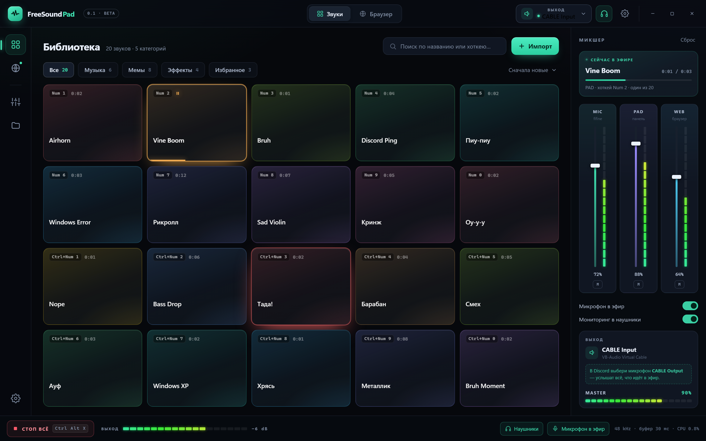
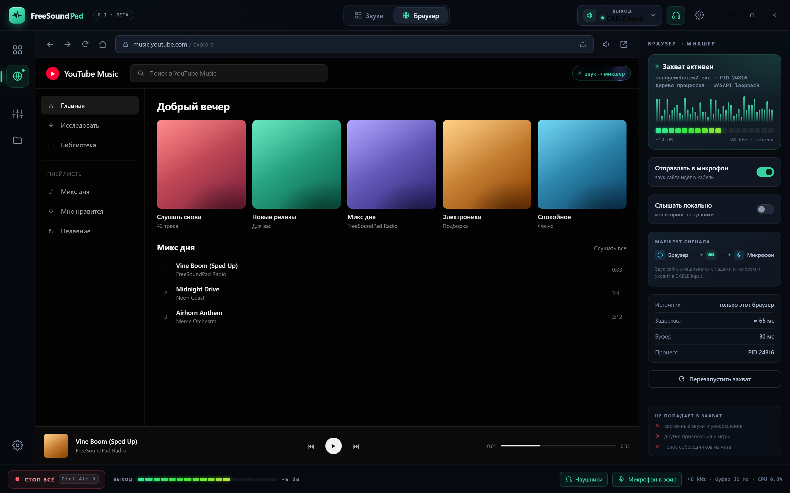
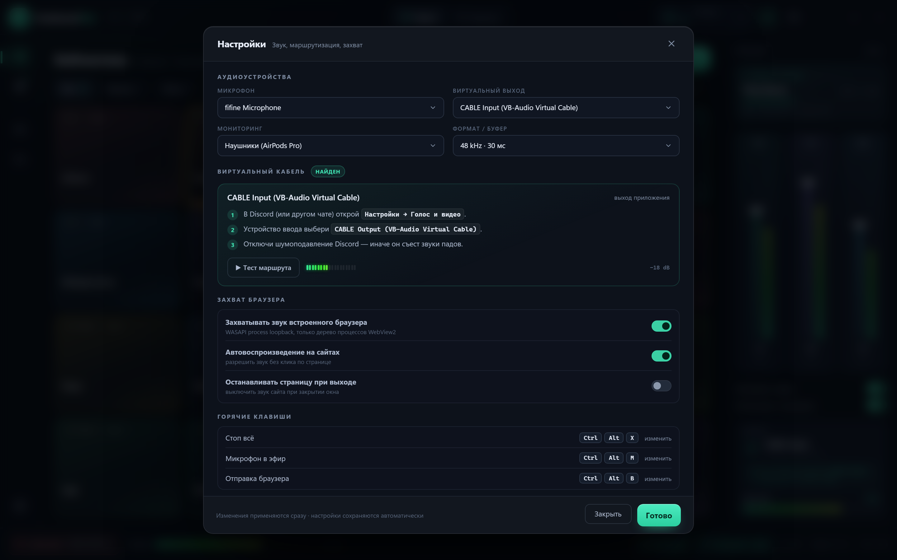

# FreeSoundPad — план разработки

> **Статус v0.1:** реализовано. Готовая сборка, инструкция по VB-CABLE, горячие клавиши и реальные скриншоты — в [README.md](../README.md). Ниже — исходный план и UI-макеты (они остались актуальными как дизайн-документ).

**Версия плана:** 0.1 · **Целевая ОС:** Windows 10 2004+ / Windows 11, x64 · **Формат поставки:** один portable `.exe`

---

## 1. Что делаем

FreeSoundPad — приложение для Windows в духе SoundPad, но с двумя источниками звука вместо одного:

1. **Звуковая панель (soundboard).** Библиотека mp3/wav, пады с горячими клавишами; звук уходит в «микрофон» — то есть в голосовой чат (Discord, Telegram, Steam, игра).
2. **Встроенный браузер.** Настоящий браузер на WebView2 (YouTube, Twitch, сайты). Захватывается **только звук этого браузера** — системные звуки, музыка из других приложений и голос собеседников в захват не попадают.
3. **Микшер.** Реальный микрофон + звуки падов + звук браузера сводятся в один поток и отдаются в виртуальный микрофон. Можно отправлять голос вместе со звуками или только звуки.

Ключевая идея: пользователь один раз настраивает маршрут «FreeSoundPad → виртуальный кабель → микрофон в Discord», дальше всё работает из трея по глобальным хоткеям.

### Границы v1

| Делаем | Не делаем в v1 |
|---|---|
| Windows 10/11 x64, portable exe | macOS / Linux / мобильные |
| mp3, wav, m4a/aac (Media Foundation) | собственный аудиодрайвер, ASIO |
| WebView2-браузер со звуком | вкладки, расширения, блокировщик рекламы |
| микшер 3 канала + мастер-лимитер | запись микса в файл (v1.1) |
| глобальные хоткеи, трей, автозапуск | облако, аккаунты, магазин звуков |
| тёмная тема, русский UI | локализация на другие языки (структурно готово) |

---

## 2. Технологический стек

| Слой | Выбор | Почему |
|---|---|---|
| Язык / рантайм | **C# 13, .NET 9** | быстрый доступ к Win32/WASAPI/COM, отличный WPF, self-contained exe |
| UI | **WPF** + кастомная тёмная тема, MVVM (`CommunityToolkit.Mvvm`) | гибкий кастомный интерфейс, зрелые контролы, WebView2 из коробки |
| Браузер | **WebView2** (Evergreen Runtime) | тот же Chromium, полная поддержка сайтов, `BrowserProcessId` для точного захвата звука |
| Звук | **NAudio 2.2** + собственный COM-interop | WASAPI capture/render, декодирование mp3 через Media Foundation, process loopback пишем сами |
| Захват звука браузера | **WASAPI Process Loopback** (`ActivateAudioInterfaceAsync`) | единственный способ захватить звук конкретного процесса без системного loopback |
| Хранилище | JSON (`System.Text.Json`), атомарная запись | без БД, portable-режим |
| Сборка | `dotnet publish -r win-x64 --self-contained -p:PublishSingleFile=true` | один exe, без установки .NET |

**Почему не Electron:** захват звука конкретного процесса из JS невозможен без нативного модуля, а два Chromium (WebView2 + Electron) — лишние 300 МБ; WASAPI-микшер всё равно писать на нативном коде.
**Почему не Python:** упаковка в exe хрупкая, UI и COM-interop для process loopback дороже в поддержке.

---

## 3. Архитектура

```
                       ┌──────────────────────── FreeSoundPad.exe (WPF) ───────────────────────┐
                       │                                                                       │
  mp3/wav ──► PadPlayer ├──► PadBus ─────┐                                                  │
  (NAudio, MediaFoundation)              │                                                  │
                       │                 ├──► Mixer ──► Limiter ──► WASAPI render ──────────┼──► «CABLE Input»
  микрофон ──► MicCapture ─► MicBus ─────┤        (float32, 48 kHz, stereo)                  │    (виртуальный кабель)
  (WASAPI)             │                 │              │                                    │
                       │                 │              └──► MonitorOut (наушники, опц.) ───┼──► наушники
  WebView2 ──► ProcessLoopbackCapture ──► WebBus ───────┘                                   │
  (только дерево процессов браузера)                                                       │
                       └───────────────────────────────────────────────────────────────────────┘
```

### 3.1. Потоки и буферы

- Микшер живёт в аудиопотоке WASAPI (event-driven, буфер 20–30 мс).
- Каждый источник пишет в свой lock-free ring buffer; микшер только читает. UI не блокирует звук.
- Метры уровня (VU) и позиции плееров отдаются в UI через атомарные значения, обновление 30 Гц.
- Буфер 48 кГц float32 stereo. Если mix-format устройства другой — ресемплинг `MediaFoundationResampler` на выходе.
- Целевая задержка тракта «нажал хоткей → звук в кабеле»: **< 80 мс**, без треска при 30+ минутах работы.

### 3.2. Захват звука браузера (главная фича)

1. WebView2 создаётся со своим user data folder (`%LOCALAPPDATA%\FreeSoundPad\WebView2`) и аргументом `--autoplay-policy=no-user-gesture-required`, чтобы сайты играли без клика.
2. После инициализации берём `CoreWebView2.BrowserProcessId` — PID именно нашего браузерного процесса.
3. Пишем `ProcessLoopbackCapture`: COM-интероп `ActivateAudioInterfaceAsync` с `AUDIOCLIENT_ACTIVATION_TYPE_PROCESS_LOOPBACK`, `ProcessLoopbackMode = INCLUDE_TARGET_PROCESS_TREE`, device path `VAD\Process_Loopback`. В capture попадают только наш браузер и его дочерние процессы (renderer/audio service), но не другие приложения.
4. Если браузерный процесс перезапустился (`ProcessFailed`) — пересоздаём захват, звук автоматически возвращается.
5. Захват работает, даже когда открыта вкладка «Звуки»: WebView2 остаётся загруженным; видимость/аудио в фоне проверяем в спайке M0.

Почему не system loopback: он захватил бы весь звук системы (чат, музыку, уведомления) — это не соответствует требованию «только встроенный браузер».

### 3.3. Маршрутизация в микрофон

Windows не позволяет обычному приложению без драйвера притвориться микрофоном. Поэтому:

- приложение выводит звук на **виртуальный кабель** (render-устройство), а в Discord/Telegram выбирается его capture-сторона;
- поддерживаем любой кабель, автоопределяем известные: **VB-CABLE** (`CABLE Input`), **VoiceMeeter** (`VoiceMeeter Input`/`Aux`), **Virtual Audio Cable** (`Line 1`), а также пары **Steam Streaming** и **Pico Streaming** (на этой машине уже есть — пригодятся для тестов);
- если кабеля нет — визард с ссылкой на VB-CABLE (бесплатный) и кнопкой «Обновить список»;
- микрофон можно подмешивать (`Mic passthrough`), тогда собеседники слышат и голос, и звуки; выключено — слышат только звуки.

### 3.4. Структура решения

```
FreeSoundPad.sln
├─ src/
│  ├─ FreeSoundPad.App/              WPF: окно, вьюхи, VM, трей, контролы
│  │  ├─ Views/                      SoundboardView, BrowserView, SettingsWindow, OnboardingWindow
│  │  ├─ ViewModels/                 MainViewModel, PadsViewModel, BrowserViewModel, MixerViewModel
│  │  ├─ Controls/                   PadTile, VuMeter, LevelSlider, ToggleSwitch, KeyBadge
│  │  └─ Resources/                  Theme.xaml, Icons.xaml, Strings.ru.resx
│  ├─ FreeSoundPad.Audio/            движок
│  │  ├─ AudioEngine.cs              владеет выходом, микшером, монитором
│  │  ├─ Mixer.cs, Limiter.cs, RingBuffer.cs
│  │  ├─ Sources/                    MicCapture, PadPlayer, PadVoicePool
│  │  ├─ Capture/ProcessLoopbackCapture.cs
│  │  ├─ Devices/AudioDeviceService.cs, VirtualCableDetector.cs
│  │  └─ Interop/                    WASAPI/COM-объявления
│  └─ FreeSoundPad.Core/             модели, JSON-хранилище, глобальные хоткеи, логи
├─ tests/FreeSoundPad.Audio.Tests/   xUnit: микшер, лимитер, ресемплинг, хранилище
├─ tools/FreeSoundPad.AudioProbe/    консольный стенд: mp3 → кабель → запись с микрофона, сверка
├─ docs/                             план, UI-макеты, README
└─ build/publish.ps1
```

---

## 4. Функциональность v1

### Звуковая панель
- импорт mp3/wav/m4a: кнопка, drag&drop, сканирование папки; по умолчанию файл копируется в библиотеку (`%APPDATA%\FreeSoundPad\sounds`);
- библиотека: пады 6 в ряд, цвет, название, длительность, мини-волна, поиск, категории, избранное, сортировка;
- воспроизведение: клик / хоткей, несколько звуков одновременно, режим «стоп предыдущего», loop, индивидуальная громкость, fade-in 10 мс от щелчков;
- горячие клавиши на каждый пад (глобальные, работают в свёрнутом окне и в borderless-игре);
- «Стоп всё», progress и индикатор на играющем паде, пик-холд и клип-индикатор.

### Браузер
- адресная строка, назад/вперёд/обновить/домой, поиск по URL/запросу (DuckDuckGo), масштаб;
- звук сайта идёт в микшер, отдельный канал `WEB` с громкостью/mute;
- переключатель «Отправлять в микрофон», «Слышать локально», статус захвата (PID, уровень, формат, задержка);
- панель показывает, что захватывается только этот браузер; кнопка перезапуска захвата.

### Микшер и системное
- каналы `MIC` / `PAD` / `WEB` + `MASTER`: громкость, mute, VU, пик;
- мастер-лимитер (мягкий клиппинг) — чтобы сумма не перегружала кабель;
- мониторинг в наушники (опционально, отдельное устройство) — слышать себя/звуки, но не отправлять в кабель;
- трей: свернуть в трей, меню «Стоп всё», «Показать окно», выход;
- настройки: устройства, буфер, автозапуск, мониторинг, хоткеи, portable-режим;
- потокобезопасное сохранение настроек и библиотеки (атомарная запись), восстановление после падения.

---

## 5. UI/UX

Тёмный «профессиональный аудио» интерфейс: фон `#07090D`, панели `#0F131B`, акцент мятный `#3FE0B0`, пады — 8 приглушённых цветов. Шрифт Segoe UI Variable, хоткеи — Cascadia Mono. Окно без стандартной рамки (кастомный заголовок, поддержка снапа Win11), 1440×900 по умолчанию, минимум 1080×680, DPI-aware.

### Макеты

**Звуковая панель + микшер**



**Браузер + панель захвата**



**Настройки и визард виртуального кабеля**



Интерактивный макет: [`docs/ui/mockup.html`](ui/mockup.html) — открывается в любом браузере, вкладки «Звуки»/«Браузер» и модалка настроек переключаются. Сделан на чистом HTML/CSS, чтобы этот же дизайн можно было один в один перенести в WPF-тему.

### Экран «Звуки»

```
┌──────────────────────────────────────────────────────────────────────────────┐
│ ◉ FreeSoundPad   [ Звуки ][ Браузер ]            [→ CABLE Input ▾] 🎧 ⚙ ─ □ ✕ │
├──────┬────────────────────────────────────────────────────┬──────────────────┤
│ ▣    │  Библиотека · 20 звуков       [поиск…] [+ Импорт]  │ МИКШЕР           │
│ ◉    │  [Все] [Музыка] [Мемы] [SFX] [★]      сортировка ▾ │ ┌ сейчас в эфире┐ │
│ 🎚    │  ┌──────┬──────┬──────┬──────┬──────┐            │ │ Vine Boom    │ │
│ 📁    │  │Num 1 │Num 2 │Num 3 │Num 4 │Num 5 │            │ │ ▓▓▓▓░░ 0:01  │ │
│ ⚙    │  │Airhorn│Vine…│ Bruh │ …    │ …    │            │ └───────────────┘ │
│      │  └──────┴──────┴──────┴──────┴──────┘            │ MIC  ▓▓▓▓▓░ 72%  │
│      │  ... 4 ряда падов                                 │ PAD  ▓▓▓▓▓▓ 88%  │
│      │                                                   │ WEB  ▓▓▓░░░ 64%  │
│      │                                                   │ MASTER ▓▓▓▓▓ 90% │
├──────┴────────────────────────────────────────────────────┴──────────────────┤
│ ⏹ СТОП ВСЁ   ▓▓▓▓▓▓░░░ ВЫХОД   🎧 монитор   🎙 микрофон в эфир   48 kHz/30ms │
└──────────────────────────────────────────────────────────────────────────────┘
```

- слева узкий рельс разделов (звуки, браузер, устройства, библиотека, настройки);
- центр — сетка падов 5×4; играющий пад подсвечивается своим цветом, показывает прогресс и паузу;
- справа — микшер: карточка «сейчас в эфире» и вертикальные фейдеры `MIC`/`PAD`/`WEB` с лесенками уровня, мастер-VU и карточка выхода с подсказкой про `CABLE Output`;
- снизу — транспорт «Стоп всё», мастер-VU, быстрые тумблеры монитора и микрофона.

### Экран «Браузер»

Слева — реальный браузер (панель навигации + страница), справа — панель «БРАУЗЕР → МИКШЕР»: зелёный статус «Захват активен», PID и дерево процессов, волна и уровень, переключатели «Отправлять в микрофон» / «Слышать локально», схема маршрута, параметры захвата и блок «не попадает в захват» (системные звуки, другие приложения, голос собеседников). Микшер в этом режиме скрыт, чтобы не мешать контенту; переключение — вкладка «Звуки».

### Настройки / визард кабеля

Модальное окно: устройства (микрофон, виртуальный выход, мониторинг), автодетект кабеля с галочкой «найден», пошаговая инструкция «выход FreeSoundPad → CABLE Input», «микрофон в Discord → CABLE Output», кнопка «Проверить маршрут» с живым индикатором уровня, горячие клавиши, автозапуск.

### Горячие клавиши по умолчанию (все настраиваются)

| Действие | Клавиши |
|---|---|
| Пады 1–10 | `Num 1` … `Num 0` |
| Пады 11–20 | `Ctrl + Num 1` … `Ctrl + Num 0` |
| Стоп всё | `Ctrl + Alt + X` |
| Микрофон в эфир (вкл/выкл) | `Ctrl + Alt + M` |
| Отправка браузера (вкл/выкл) | `Ctrl + Alt + B` |
| Мониторинг (вкл/выкл) | `Ctrl + Alt + H` |
| Показать окно | `Ctrl + Alt + F` |

---

## 6. Этапы

### M0. Технический спайк (сначала самое рискованное)
- [ ] `ProcessLoopbackCapture`: звук YouTube из WebView2 записывается в WAV; **в запись не попадают** звуки других приложений.
- [ ] Проверить поведение при mute/скрытии браузера, при перезапуске browser-процесса.
- [ ] Проверить маршрут через виртуальную пару (Steam/Pico) и записать результат вторым концом.
- [ ] Замерить реальную задержку.

**Критерий:** WAV с чистым звуком сайта; понятно, как ведёт себя захват в пограничных случаях.

### M1. Аудиоядро
- [ ] устройства и hot-plug, микшер, лимитер, ресемплинг, VU;
- [ ] плеер mp3 с несколькими голосами, стоп/loop/громкость;
- [ ] захват микрофона и passthrough; мониторинг;
- [ ] консольный `AudioProbe`: mp3 → кабель → запись → сверка по сигналу.

### M2. Soundboard
- [ ] UI звуков, импорт/drag&drop, библиотека и категории, поиск;
- [ ] persistence, хоткеи, контекстное меню пада, редактирование (имя/цвет/громкость/хоткей).

### M3. Браузер
- [ ] WebView2, навигация, настройки autoplay, страница ошибок;
- [ ] интеграция захвата в микшер, панель статуса, оба тумблера, перезапуск захвата.

### M4. Полировка и сборка
- [ ] настройки, визард виртуального кабеля, онбординг первого запуска;
- [ ] трей, автозапуск, обработка отсутствия WebView2 Runtime;
- [ ] иконка, single-file exe, portable-режим, README, `build/publish.ps1`.

### M5. Приёмка
- [ ] проверка в реальном звонке Discord (кабель ↔ микрофон);
- [ ] прогон 30 минут без дропов/треска, CPU/RAM в норме;
- [ ] чистая Win11 без .NET: exe запускается (self-contained);
- [ ] сценарий «нет виртуального кабеля» — визард ведёт за руку.

---

## 7. Риски и неизвестные

| Риск | Вероятность | Митигация |
|---|---|---|
| Process loopback не захватывает mute/скрытый WebView2 | средняя | спайк M0; не глушим страницу, держим её загруженной; отдельный render для монитора |
| Нет виртуального кабеля у пользователя | высокая | автодетект, визард, ссылка на VB-CABLE, поддержка любых кабелей; свой драйвер — вне v1 (нужна подпись) |
| Расхождение часов двух выходов (кабель + наушники) | средняя | общий микс, дрейф-компенсация по заполнению буфера, короткие фейды |
| WebView2 Runtime отсутствует | низкая | проверка при старте + кнопка установки (Evergreen bootstrapper) |
| Неподписанный exe ругается SmartScreen/антивирус | высокая | README с пояснением; в перспективе — подпись |
| Глобальные хоткеи не работают в exclusive fullscreen | средняя | документируем: borderless/windowed; запасные комбинации |
| Эхо при мониторинге в колонки | средняя | по умолчанию мониторинг выключен, предупреждение «используйте наушники» |
| Треск/дропы под нагрузкой | средняя | lock-free буферы, приоритет аудиопотока, лимитер, тесты 30+ мин |

---

## 8. Критерии приёмки v1

1. `FreeSoundPad.exe` (один файл, без установки) запускается на чистой Windows 11 x64.
2. Звук mp3-пада и голос микрофона одновременно слышны в Discord при `Mic passthrough = on`.
3. Звук YouTube из встроенного браузера слышен в Discord; музыка из другого приложения (например, Foobar) **не попадает**.
4. Хоткеи срабатывают при свёрнутом окне.
5. Настройки, библиотека и хоткеи переживают перезапуск.
6. 30 минут непрерывного микса — без дропов и клиппинга; задержка тракта < 80 мс.
7. Если кабеля нет — понятный визард, а не молчаливая тишина.
8. Ошибки (нет WebView2, занято устройство, битый mp3) показываются человеческим текстом.

---

## 9. Вопросы к пользователю (можно ответить после макетов)

1. **Виртуальный кабель.** Ставим бесплатный VB-CABLE (рекомендую) или используем уже установленный на этой машине `PicoStreamingMicrophone`/`Steam Streaming`? От этого зависит только инструкция визарда — движок поддерживает любой.
2. **Голосовой чат** — Discord? Нужны ли отдельные пресеты для Telegram/OBS?
3. **Запись микса в файл** — нужна в v1 или можно отложить?
4. **Язык интерфейса** — только русский или сразу RU/EN?
